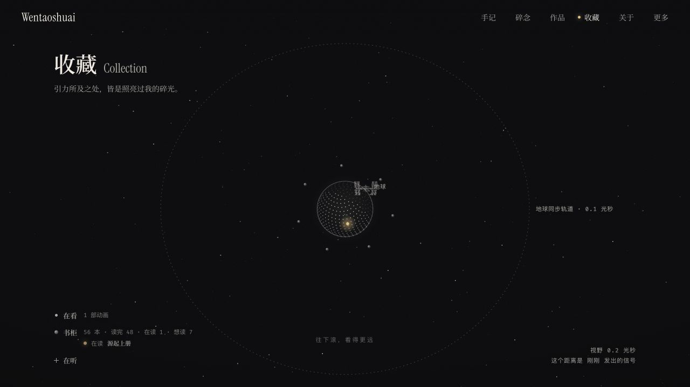

# 梁文韬的个人网站 · Wentaoshuai

[English](./README_EN.md) · [访问 hiwentao.com](https://hiwentao.com/) · [支持我](#支持我)

这里是我放作品、手记、读书记录和小工具的地方。我关注产品设计和日常体验，也会把好奇的想法做成能亲手试一试的东西。

## 网站预览

- [收藏](https://hiwentao.com/zh-cn/watch/) — 最近在看的作品、在读的书和想留住的声音。
- [手记](https://hiwentao.com/zh-cn/blog/)与[碎念](https://hiwentao.com/zh-cn/thinking/) — 记录阅读、设计、AI 实验和日常观察。
- [作品](https://hiwentao.com/zh-cn/portfolio/) — 个人项目、交互实验和小工具。
- [旧版书单](https://hiwentao.com/archive/115/books/) — 按年份整理的读书记录，包含封面和简介。

## 关于作者

我是**梁文韬（Wentaoshuai）**。我喜欢把想法做成清楚、好用的体验，也会把读到的东西带回日常设计和创作中。[网站个人介绍](https://hiwentao.com/zh-cn/about/) · [GitHub @wentao-tab](https://github.com/wentao-tab)

## 支持我

如果你喜欢这里的内容，欢迎把网站分享给同样感兴趣的人，或给[这个仓库点个 Star](https://github.com/wentao-tab/public-portfolio-site)。谢谢你来逛。

## 本地预览

在仓库根目录运行 `npm run dev`，然后打开 [localhost:14002](http://127.0.0.1:14002/)。`npm run build` 会把新版静态导出和旧版归档组装到 `dist/`，供 GitHub Pages 发布。[站点维护说明](./next-site/README.md)

## 致谢与许可

- 新版基于 [timo9378/sora-to-ki](https://github.com/timo9378/sora-to-ki)。[新版源码](./next-site/source/) · [AGPL-3.0](./next-site/source/LICENSE)
- 旧版基于 [ricocc/public-portfolio-site](https://github.com/ricocc/public-portfolio-site)。[个站旧版 115](https://hiwentao.com/archive/115/) · [MIT](./LICENSE)
