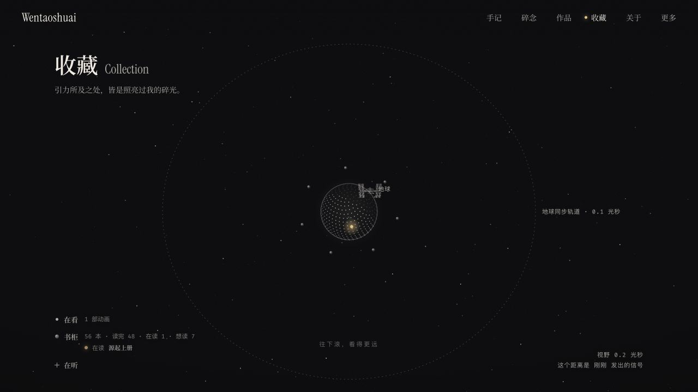

# Wentao Liang's Personal Site · Wentaoshuai

[简体中文](./README.md) · [Visit hiwentao.com](https://hiwentao.com/) · [Support my work](#support-my-work)

This is where I keep my projects, essays, reading notes, and small tools. I'm interested in product design and everyday experiences, and I like turning questions into things people can try.

## Site preview

- [Collection](https://hiwentao.com/en/watch/) — Things I'm watching, reading, and listening to.
- [Blog](https://hiwentao.com/en/blog/) and [Thoughts](https://hiwentao.com/en/thinking/) — Notes on books, design, AI experiments, and daily life.
- [Works](https://hiwentao.com/en/portfolio/) — Personal projects, interactive experiments, and small tools.
- [Reading archive](https://hiwentao.com/archive/115/books/) — My reading lists by year, with covers and short notes in Chinese.

## About the author

I'm **Wentao Liang (Wentaoshuai)**. I like making things that are clear and useful, and bringing what I learn from books back into my design work and personal projects. [About me](https://hiwentao.com/en/about/) · [GitHub @wentao-tab](https://github.com/wentao-tab)

## Support my work

If you enjoy the site, share it with someone who might like it or [star this repository](https://github.com/wentao-tab/public-portfolio-site). Thanks for stopping by.

## Preview locally

Run `npm run dev` from the repository root and open [localhost:14002](http://127.0.0.1:14002/). `npm run build` assembles the current static export and the legacy archive in `dist/` for GitHub Pages. [Maintenance guide (Chinese)](./next-site/README.md)

## Credits and licenses

- The current site builds on [timo9378/sora-to-ki](https://github.com/timo9378/sora-to-ki). [Source](./next-site/source/) · [AGPL-3.0](./next-site/source/LICENSE)
- The archived site builds on [ricocc/public-portfolio-site](https://github.com/ricocc/public-portfolio-site). [Version 115 archive](https://hiwentao.com/archive/115/) · [MIT](./LICENSE)
